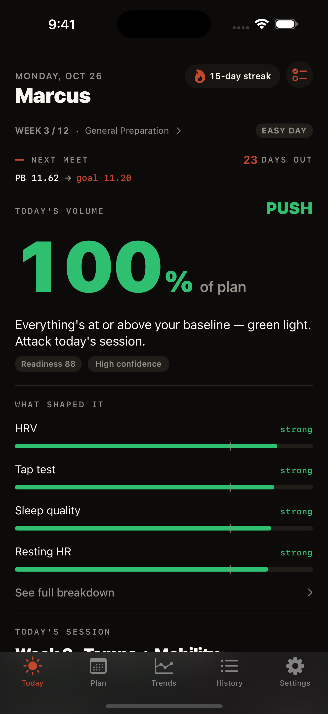
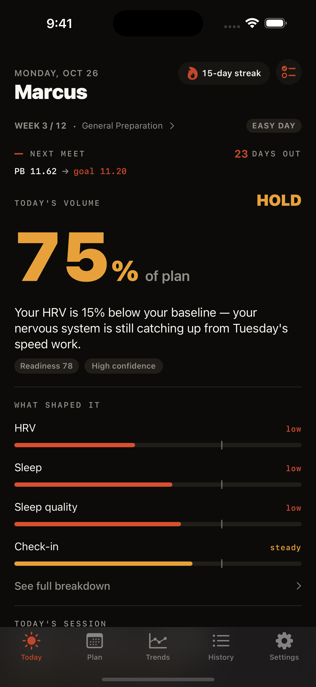
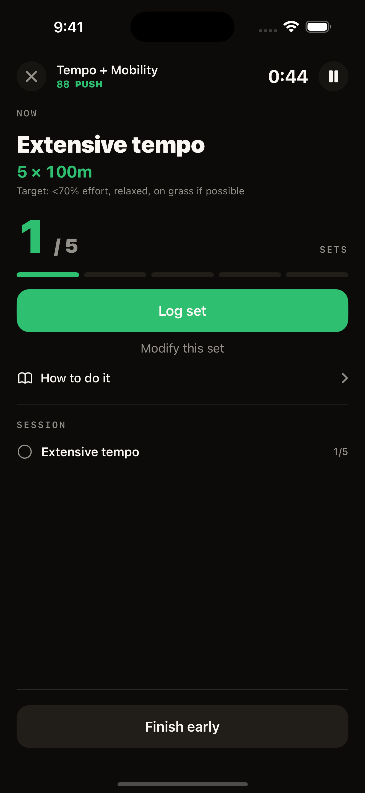
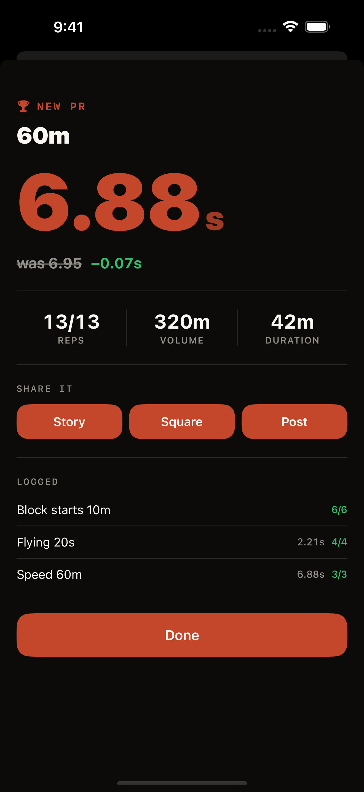

# Cadence

**An iPhone app that tells a high-school sprinter how hard to train today.**

Every morning Cadence reads recovery data from Apple Health, scores it against the
athlete's own baseline, and scales that day's session from a 12-week plan to match.
Everything runs on the phone: no account, no network calls, no analytics.

<p>
  
  
  
  
</p>

## The problem

Sprint training is hard on the nervous system, and teenagers are the people worst at
judging when to back off. Most follow a fixed plan whatever state they're in, and
either grind into injury and plateaus or guess and undertrain. The tools split the
problem in half: recovery wearables give you a score and no idea what to do with it,
and training apps give you a plan that ignores whether you slept.

Cadence connects the two. The output isn't "readiness 78" — it's **"run 75% of today's
session, and here's why."**

## How it works

1. **Check in (about a minute).** Five one-tap questions — sleep, soreness, fatigue,
   stress, mood — plus an optional 10-second finger-tap test and a jump test measured
   with the phone's accelerometer. Athletes without a watch still get a usable score.
2. **Get a verdict.** Up to ten signals are compared with the athlete's own rolling
   baseline and combined into one call:

   | Verdict | What happens to today |
   | --- | --- |
   | **Push** | The full session — 100% |
   | **Hold** | Trimmed to match, e.g. 80% |
   | **Back off** | Swapped for recovery work |

   Every verdict comes with the reason in plain words: *"Your HRV is 15% below your
   baseline — your nervous system is still catching up from Tuesday's speed work."*
3. **Train a session that's already scaled.** Reps are cut to the day's volume before
   the athlete starts.
4. **Log it.** The rest timer runs on the Lock Screen and Dynamic Island, and a
   notification fires when rest is up, even with the phone in a pocket.

### The scoring, briefly

Each signal becomes a z-score against the athlete's baseline, then a 0–100 subscore
centred at 72, so a normal day reads as normal and only below-baseline signals pull
toward caution. The weighted score maps to a volume multiplier between 50% and 100%:

```
subscore   = clamp(72 + z × 20, 0…100)
multiplier = 0.5 + 0.5 × (score / 100)          # never below 50%
verdict    = push ≥ 0.83 · hold ≥ 0.70 · else back off
```

Safety rails sit on top: volume is capped when signals disagree or there isn't enough
history yet, and a back-off day is never zero.

## Features

- Morning check-in with tap and jump tests
- Readiness from HRV, resting heart rate, sleep and sleep stages, breathing rate,
  wrist temperature and training load (Apple Health)
- Recalculates when a wearable syncs late
- Three periodized 12-week plans (100m, 200m, 400m) with a taper before meets
- Session player with set tracking, rest timer, Live Activity and rest alerts
- PR detection and shareable PR cards
- Trends, season history and a weekly report
- Home Screen widget
- VoiceOver labels on every custom control; every animation respects Reduce Motion

## Privacy

Nothing leaves the device. Health data is read, never written, and never uploaded.
There is no account, no server and no third-party SDK. See [PRIVACY.md](PRIVACY.md).

## Built with

- **SwiftUI** and **SwiftData**, iOS 18+
- **HealthKit** with background delivery
- **ActivityKit** (Live Activities) and **WidgetKit**
- **Swift 6** strict concurrency
- `CadenceCore` — a pure Swift package holding the scoring engine, plan scheduling and
  session scaling, with no UI or HealthKit dependencies so it can be tested in isolation

```
CadenceApp/            the iOS app: screens, services, models
Packages/CadenceCore/  scoring engine, plan logic, scaling (pure Swift)
CadenceWidgets/        Home Screen widget + rest-timer Live Activity
CadenceTests/          app integration tests
```

## Running it

Requires Xcode 26 or later and an iPhone or simulator on iOS 18+.

1. Open `Cadence.xcodeproj`.
2. Set your own development team under *Signing & Capabilities* for both the
   `Cadence` and `CadenceWidgetsExtension` targets.
3. Build and run the `Cadence` scheme.

On a simulator there's no Health data, so the score comes from the check-in alone.

Tests:

```bash
cd Packages/CadenceCore && swift test
```

The app-level tests run from the `Cadence` scheme in Xcode (⌘U).

## Status and limitations

- Only the 100m, 200m and 400m have plans. Hurdles and relay are not offered until
  real plans exist.
- The weights for the phone-only signals (check-in, tap test, jump test) are
  first-pass estimates. The app says so on those signals' detail screens.
- The scoring is grounded in published sports-science principles, but it has not
  been validated against injury or performance outcomes.

*Cadence is a training-readiness tool, not medical advice.*
